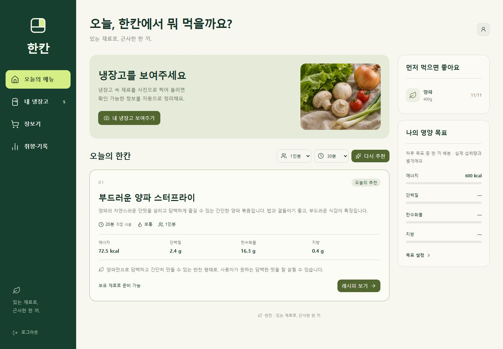

# 한칸 · Han-Kan

**있는 재료로, 근사한 한 끼.**

내 재료와 취향을 아는 AI 식사 도우미.



> 샘플 데이터로 촬영한 개발 화면입니다.

ChatGPT 로그인으로 사용하는 개인용 모바일 웹앱입니다. 보유 식재료와 기한, 취향, 영양 목표를 바탕으로 한 끼를 제안합니다. Vinext/React, Cloudflare D1/R2, OpenAI Responses API, 식약처 식품영양성분 DB를 사용합니다.

## 기능

- 냉장·냉동·실온 재고를 포장별로 관리하고 변경 전후 조회와 취소를 지원합니다.
- 구매 캡처, 식재료, 냉장고 사진을 최대 4장씩 자르고 분석합니다. 확인 가능한 필드만 반영하며 미수령 상품, 가려진 수량, 기존 포장이 불명확한 결과는 확인을 받습니다. 동일 이미지 해시와 유사 이미지 지문을 검사합니다.
- 레시피 개발 → 영양/장보기 병렬 검토 → 최대 한 번 수정 → 최종 제한 재검사로 추천합니다. 기본 1개와 최대 2개 대안을 제시하며 조건에 맞지 않으면 이유를 표시합니다.
- 조리 단계·타이머, 실제 사용량 차감, 별점·맛·양·난이도·시간·재조리 의향을 기록합니다. 평가를 다음 추천 순위와 AI 문맥에 반영합니다.
- 장보기 구매 완료는 실제 수령 재료 등록으로 연결됩니다. 체크만으로 재고를 증가시키지 않습니다.
- 설치 가능한 PWA입니다. AI와 저장 작업은 온라인으로 사용하며 개인 데이터를 서비스 워커에 캐시하지 않습니다.

## 실행 및 비밀값

Node 22.13 이상에서 `npm install`, `npm run dev -- --hostname 127.0.0.1`로 실행합니다. 로컬 개발은 Sites 스타터의 루프백 전용 가상 계정을 사용하고, 배포 환경은 Sites 인증을 사용합니다.

`.env.example`을 `.env.local`로 복사한 다음 `OPENAI_API_KEY`, `MFDS_API_KEY`, 선택적으로 `OPENAI_MODEL`을 설정합니다. 기본 모델은 `gpt-4.1-mini`입니다. 배포 비밀값은 Sites 환경 변수에 별도로 저장해야 합니다. 키가 없으면 UI에 미연동으로 표시합니다. 발급한 키의 만료 전에 교체해야 합니다.

`.openai/hosting.json`의 `DB`와 `BUCKET` 바인딩을 유지합니다. `drizzle/0000_red_metal_master.sql`이 계정 상태, 작업, 영양 캐시, 요청 영수증 테이블을 만듭니다. Sites 배포 과정에서 마이그레이션을 적용합니다. 로컬 DB는 Wrangler의 `.wrangler/state`에 보관합니다.

공개 소스에는 개인 배포의 `project_id`, API 키, 사용자 재고, 업로드 사진, 로컬 데이터베이스가 포함되지 않습니다. Sites에 배포하려면 새 프로젝트를 등록하고 발급된 ID를 `.openai/hosting.json`에 설정한 뒤 서버 비밀값을 등록하세요. 일반 정적 호스팅만으로는 AI·인증·D1/R2 기능이 동작하지 않습니다.

처음 로컬 실행할 때 데이터베이스 테이블을 생성하세요. 기본 작업 디렉터리에서 다음 명령을 실행하고 개발 서버를 시작합니다.

```sh
npm run build
node --import ./scripts/sites-env.mjs ./node_modules/wrangler/bin/wrangler.js d1 execute DB --local --config dist/server/wrangler.json --persist-to .wrangler/state --file drizzle/0000_red_metal_master.sql
```

## 구현 구조

- `app/api/chef/route.ts`: 인증된 사용자만 접근하는 조회·사진 업로드·재고·추천·장보기·요리 API
- `lib/store.ts`: 사용자별 D1 상태와 버전 CAS, 영구 요청 영수증, 작업 단계/임대
- `lib/domain.ts`: 필드별 재고 반영, 변경 취소, 제외 식품 검사, 재료 부족분, 평가 기반 순위, 수량 차감
- `lib/jobs.ts`: 서버의 역할별 호출과 단계 복구. 모델은 데이터베이스 변경 권한 없이 구조화된 결과만 반환
- `lib/nutrition.ts`: 식약처 조회·30일 캐시, 확인한 제품 라벨 우선, 재료량과 인분에 따른 산술 계산
- `components/chef-*`, `components/photo-picker.tsx`: 반응형 화면과 입력·요리 흐름

사진은 서버 R2 임시 저장 후 분석 성공/실패 시 삭제합니다. AI 호출에는 `store:false`를 사용하며 사진 속 지시문은 데이터로 취급합니다. 추출 결과와 변경 기록은 남습니다. AI 호출과 재고 쓰기를 분리했습니다. 동시 수정은 버전 충돌로 거절하고, 동일 요청은 한 번만 반영합니다.

## 검증

- `node --test tests/domain.test.mjs`: 포장 용량/잔량, 가려진 재료, 날짜, 미수령·불명확 구매, 사진 유사성, 재고 변경 취소·버전 충돌, 알레르기·대체안, 인분별 영양·결측값, 과다 차감·중복 완료, 낮은 평가 순위 검증
- `npx tsc --noEmit`: 타입 검사
- `node --experimental-sqlite --test tests/store.test.mjs`: 실제 SQLite SQL로 두 사용자 상태·작업 분리와 오래된 요청 재시도 검증
- `node scripts/integration-test.mjs`: 실행 중인 로컬 서버의 인증, 교차 출처 거절, 재시도, 오래된 버전 거절, 작업 범위, 변경 취소 검증
- `node scripts/live-test.mjs`: **실제 유료 OpenAI 요청**과 식약처 요청을 수행합니다. 로컬 샘플 계정에 추천·장보기·평가를 저장하고 샘플 재고를 차감하므로 테스트 데이터만 넣고 사용합니다.

실제 연결 검증에서 생성한 식재료 사진을 분석했고, 메뉴 추천·장보기·평가·재고의 한 번 차감 흐름을 확인했습니다. 390px 모바일 화면의 저장 및 가로 넘침을 확인했습니다. 실제 휴대폰 카메라와 OS 설치·권한 거부 동작은 별도의 기기 검증이 필요합니다.

## 데이터와 범위

영양 수치는 확인한 제품 라벨 또는 정확히 대응되는 식약처 레코드로 계산합니다. 단위 변환이 확인되지 않은 개수·팩·ml, 여러 상품으로 해석되는 이름, DB 결측값은 0으로 대체하지 않습니다. 해당 영양 합계는 미상으로 표시하고 출처·미확인 재료를 제공합니다. 현재 일반 단위 환산 및 광범위한 식품 동의어 사전은 지원하지 않습니다. 영양 목표는 입력한 한 끼 배분값과 비교하며 기록하지 않은 식사까지 하루 목표를 달성했다고 표시하지 않습니다.

사진으로 신선도나 식품 안전을 판정하지 않습니다. 알레르기는 명시적 문자열/복합 성분 검사와 AI 최종 검사를 함께 적용하지만 제품 라벨 확인이 필요합니다. 주간 식단, 공유, 상품 검색·결제는 포함하지 않습니다.

공식 자료: [식약처 API](https://www.data.go.kr/data/15127578/openapi.do), [Responses 이미지 입력](https://developers.openai.com/api/docs/guides/images-vision), [구조화된 출력](https://developers.openai.com/api/docs/guides/structured-outputs).
